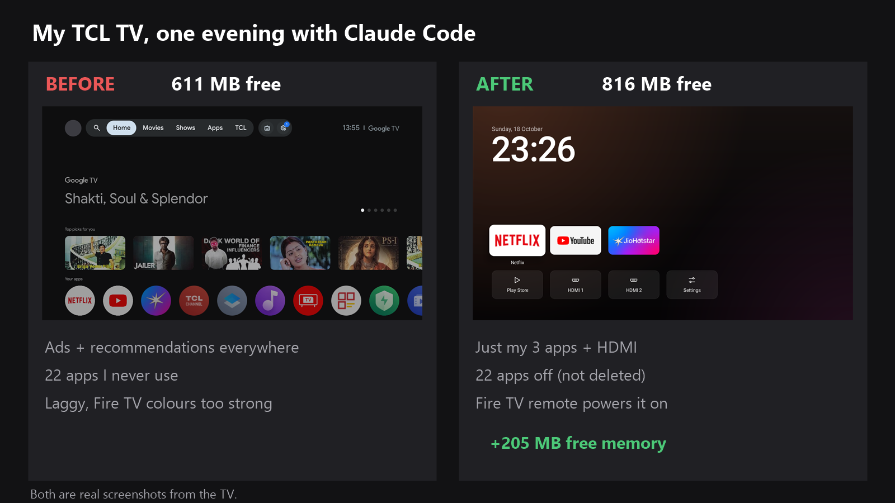

# tcl-tv-detox

How I made my old TCL 32S5500 Android TV fast and calm again in one evening, using Claude Code over Wi-Fi.



**👉 Want to do this on your TV? Follow the [step-by-step guide](GUIDE.md).**

**📱 Also in this repo: [Realme GT 6 phone debloat](realme-gt6/).** 53 bloat apps removed, background drainers blocked, a security check, and screen-on time per charge up from 5h 44m to 7h 17m.

## What changed

- **22 apps switched off** (not deleted): unused streaming apps, TCL ads and promos, Google TV extras, voice search
- **Free memory: 611 MB → 816 MB** (of 1.4 GB)
- **New home screen** from [tv-detox](https://github.com/Ansub/tv-detox): just Netflix, YouTube, JioHotstar, HDMI inputs, Play Store and Settings
- **HDMI tile fix for TCL TVs**, explained below
- **Fire TV Stick**: HDMI-CEC on, so the Fire TV remote turns the TV on straight into Fire TV. The TV also starts on the last input used
- **Picture**: Dynamic Color off, Colour space Auto, and the Fire TV's Dynamic Range set to Adaptive (its colours were far too strong)
- Animations and screensaver off

The full list, with an undo command for every change, is in [tv-changes.md](tv-changes.md).

## The TCL HDMI fix

tv-detox's HDMI tiles open Android's stock Live TV app (`com.android.tv`). TCL TVs report that app as available, but starting it shows nothing, so the tiles did nothing. [`tvhome-build/`](tvhome-build/) holds a patched copy that sends a plain "open this input" request instead. TCL's own TV app (`com.tcl.tv`) picks that up and switches input.

Build it on Windows with Android SDK build-tools 30.0.2, platform android-30 and JDK 14 or newer:

```powershell
powershell -File tvhome-build\build.ps1
adb install tvhome-build\out\tvhome.apk
```

The first build creates `key.jks`, the signing key. Keep it private, because later updates must be signed with the same key. `.gitignore` keeps it out of this repo.

## Credits

The home screen is [tv-detox](https://github.com/Ansub/tv-detox) by Ansub Khan (MIT licence, see [tvhome-build/LICENSE](tvhome-build/LICENSE)). This repo adds the TCL HDMI patch and a Windows build script.

*Use at your own risk. Every change here can be undone, but check [tv-changes.md](tv-changes.md) before you copy it to your own TV.*
