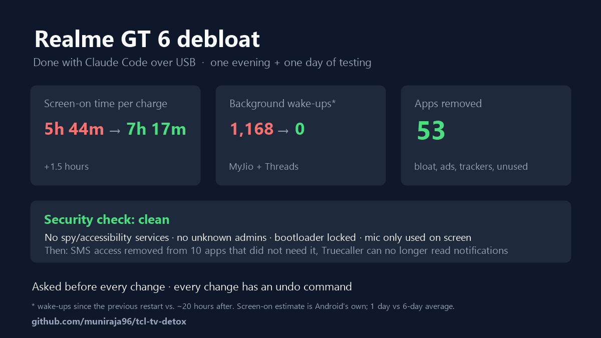

# Realme GT 6 debloat

How I cleaned up my Realme GT 6 (RMX3851, Android 16 / Realme UI 7) over a USB cable with Claude Code: bloat removed, battery drainers blocked, and a security check. No root needed.



## Results

| | Before | After |
|---|---|---|
| Screen-on time per full charge (Android's own estimate) | 5h 44m | **7h 17m** |
| Minutes of screen-on use per 1% battery | 3.7 (6-day average) | **4.5** (+22%) |
| Background wake-ups from MyJio + Threads | 1,168 since the last restart | **0** in ~20 hours |
| Apps removed | | **53** (+2 disabled) |

Screen-off drain didn't change, because it was already low: about 0.3–0.5% per hour when the phone was untouched. What's left is screen time, notification wake-ups and Bluetooth for the watch and earbuds. The "after" figures cover one day, so treat them as an early reading.

## What was changed

**Removed for the main user only** (`pm uninstall --user 0`). Built-in apps can be brought back with one command.
- **Ads and feeds:** Taboola news feed, Glance lock-screen ads, HeyTap Browser, HeyTap Music
- **Facebook stubs that come pre-installed:** App Manager, Services, System
- **Realme tracking and diagnostics:** Statistics, Logkit, Feedback
- **Unused extras:** Redtea roaming, User Manual, Easter egg, basic screensaver, email/bookmark providers
- **Unused Google/Realme/Microsoft apps:** Meet, Android Auto, Realme global search, Link to Windows (3 apps), Realme Link
- **Unused or duplicate Play Store apps:** downloaders, duplicate browser, UPI app, shopping and news apps, and so on

**Disabled:** Game Center, and HeyTap push (`com.heytap.mcs`), which caused about 220 wake-ups a day.

**Blocked from running in the background** (`appops RUN_ANY_IN_BACKGROUND ignore`): MyJio, Threads, Amazon, CRED, Apollo 24|7. They work normally when opened, but can't run after you leave them.

**Privacy:**
- SMS access removed from 10 shopping and utility apps. Banking and UPI apps keep it. OTP auto-fill mostly still works through Google's SMS Retriever.
- Truecaller can no longer read notifications. Caller ID still works.

**Kept on purpose:** everything my Galaxy Watch7 needs (Galaxy Wearable, Watch7 plugin, Samsung Health), banking and UPI apps, and authenticators.

## Security check

| Check | Result |
|---|---|
| Accessibility services (the main tool spy apps use) | None enabled |
| Device admins on the personal profile | None |
| Apps installed from outside the Play Store | None, apart from Realme's own |
| Proxy, VPN, custom DNS, wireless debugging | None / off |
| Bootloader and verified boot | Locked / green |
| Microphone use | Only while the app was on screen, or during calls |
| "Allow all the time" location | Only Fitbit, among installed apps |

## Things that tripped me up

- **Realme blocks the background-block command** until you switch on Developer options → **Disable permission monitoring**. Realme switches it back off after every restart. Blocks already set survive the restart.
- **Some Realme apps can't be removed or disabled**, such as App Market, Instant apps and `heytap.htms`.
- **`pm uninstall --user 0` deletes a Play Store app completely**, so it can't be restored with `install-existing`. Two apps I needed (YouTube Music, Watch7 plugin) had to be reinstalled from the Play Store. Check `pm list packages -3` before calling a removal "reversible".
- **A USB connection to the PC charges the phone**, and Android resets its battery stats each time you unplug it. For a fair before/after comparison, use the daily discharge-step history in `dumpsys batterystats` (the minutes each 1% lasted), not the "since last charge" numbers.

## Undo

[`restore.ps1`](restore.ps1) brings back any removed app, re-enables disabled ones, lifts background blocks and gives back SMS access:

```powershell
.\restore.ps1                       # restore everything
.\restore.ps1 com.heytap.browser    # restore one app
```

## When you're done

Turn off **USB debugging** and **Disable permission monitoring** in Developer options.
